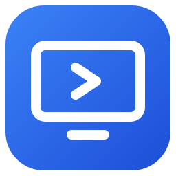
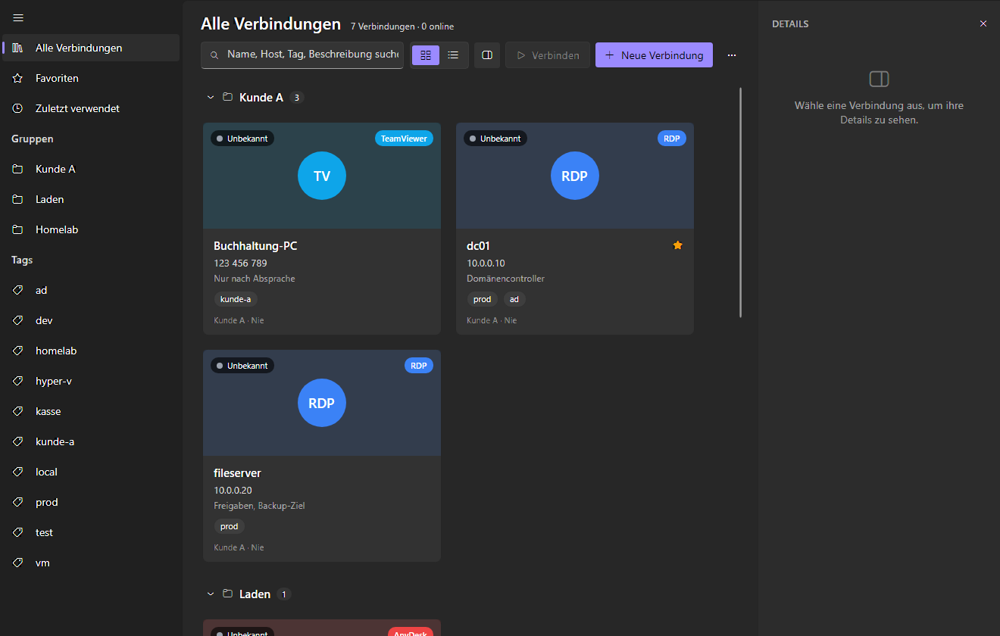
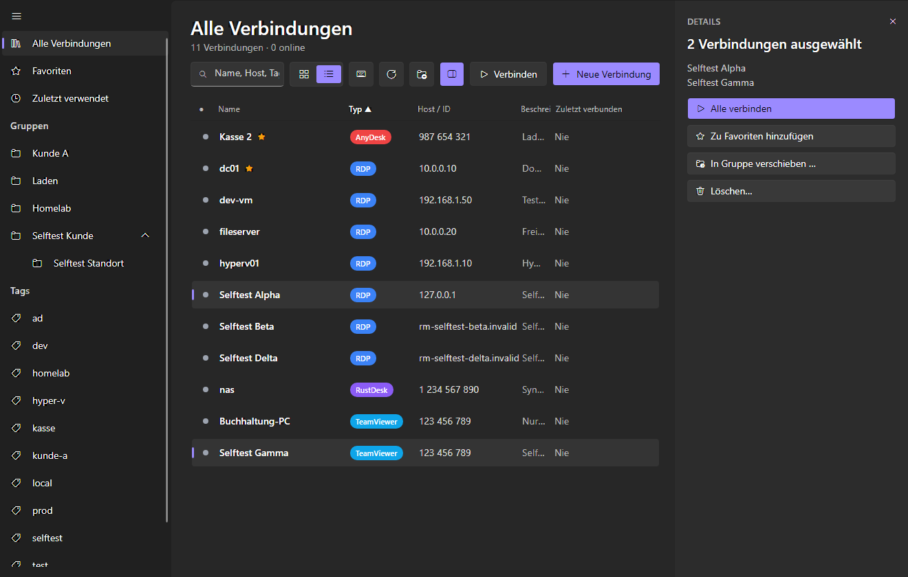
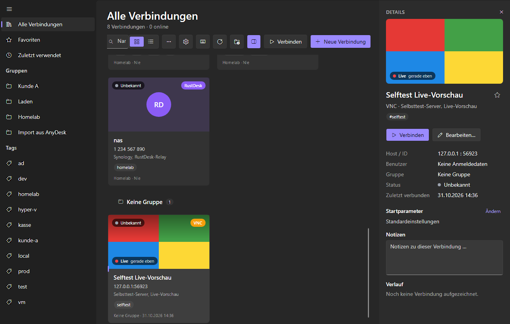
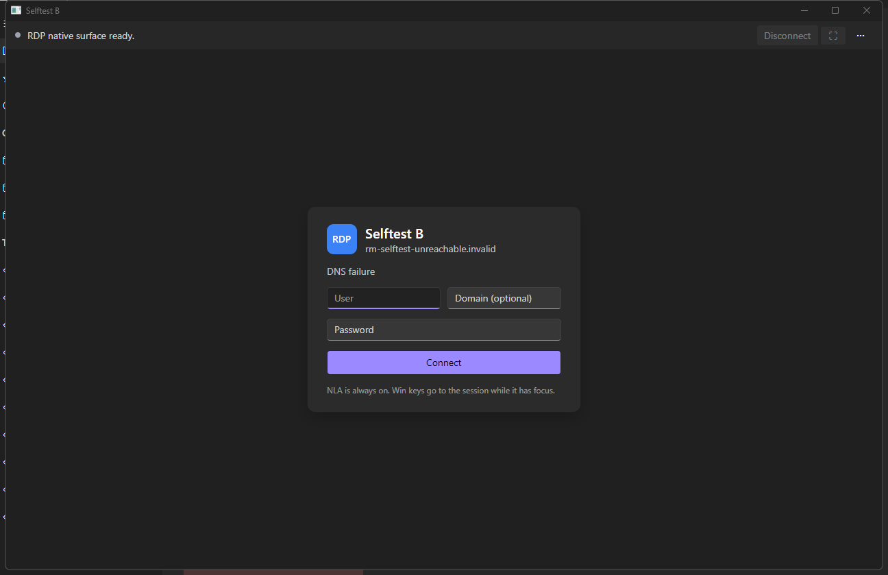
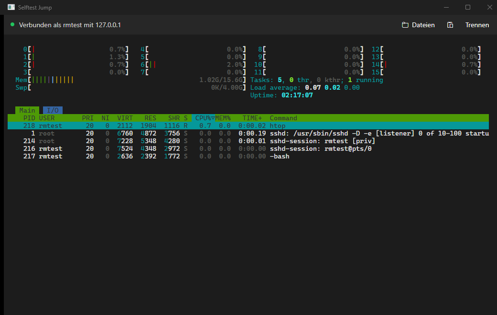

<p align="center">
  
</p>

<h1 align="center">Remote-Manager</h1>

<p align="center">
  A modern remote connection manager for Windows: a replacement for 1Remote and RDCMan.<br />
  <em>Alle Fernverbindungen an einem Ort.</em>
</p>

Remote-Manager keeps your RDP, SSH, SFTP, VNC, TeamViewer, AnyDesk, and RustDesk connections in one place,
organized in groups and tags, with live previews and online status. RDP, SSH, SFTP, and VNC sessions run
embedded in the app; TeamViewer, AnyDesk, and RustDesk are launched with the right parameters. The user
interface is in German.



## Features

- **Overview:** tile and list views with groups (nested, collapsible, drag and drop), tags, favorites,
  recently used, a detail panel, search, and a quick launcher (Strg+Alt+R anywhere, Strg+K in the app).
- **Previews and status:** tiles show a snapshot of the last session, refreshed live while an RDP or VNC
  session is open. A TCP check shows online, offline, or unknown.
- **Embedded RDP** through [MsRdpEx](https://github.com/Devolutions/MsRdpEx), each session in its own window.
  Extended options per connection: NLA, admin session, Restricted Admin and Remote Credential Guard, RD
  Gateway, redirections, audio, start program, multi-monitor, direct Windows logon with the stored password.
  RemoteApp and "open with mstsc" go through a temporary .rdp file.
- **SSH and SFTP:** xterm.js terminal, SFTP file browser with drag and drop uploads, host key checks, jump
  hosts, SSH agent, and RDP or VNC through an SSH tunnel.
- **VNC:** embedded viewer, or an external VNC viewer.
- **TeamViewer, AnyDesk, RustDesk:** launched externally with their command-line options. The password goes
  to AnyDesk on stdin; for TeamViewer and RustDesk it is copied to the clipboard and cleared again after 30 s.
  Optional TeamViewer account sync and AnyDesk CSV import.
- **Import:** 1Remote and PRemoteM (database or .prma export), RDCMan (.rdg), mRemoteNG (confCons.xml),
  and .rdp files. Export and restore as a JSON backup (without passwords).
- **Passwords:** stored in the Windows Credential Manager, never in the database. Alternatively a reference
  to a KeePass entry (.kdbx, read-only) or a 1Password item (`op://`, via the 1Password CLI). Groups pass
  their logon on to their connections.
- **Encrypted sync** between PCs through one file in a folder you choose (OneDrive, Syncthing, a share):
  AES-256-GCM with an Argon2id key from your passphrase, three-way merge with conflict resolution. Passwords
  are never synced.
- **Updates:** per-user installer, delta updates from GitHub Releases, and a database backup before every
  update.

| | |
| --- | --- |
|  |  |
|  |  |

## Install

Requirements: Windows 10 or 11, x64.

1. Download from the [latest release](https://github.com/B0tis/remote-manager/releases/latest):
   - `Botis.RemoteManager-win-Setup.exe`: installer, recommended (gets updates), or
   - `Botis.RemoteManager-win-Portable.zip`: unzip and run `RemoteManager.App.exe`.
2. Run it. Setup installs for the current user only, without admin rights, to
   `%LOCALAPPDATA%\Botis.RemoteManager`.

> **SmartScreen:** the binaries are not code-signed yet, so Windows may show "Windows protected your PC".
> Click **More info** › **Run anyway** if you trust the download.

**Where your data lives:** `%LOCALAPPDATA%\RemoteManager` (database, previews, backups). Passwords and
tokens are in the Windows Credential Manager (`RemoteManager:*`). Uninstalling removes the program and keeps
your data. Set `REMOTE_MANAGER_DATA` to use another data folder.

**Updates:** the installed app checks GitHub Releases at startup (at most once a day) and on
"…" › "Nach Updates suchen". No account or token is needed; see [docs/updates.md](docs/updates.md) for
custom update sources and the optional GitHub token.

## Build from source

Requirements: Windows and the [.NET 10 SDK](https://dotnet.microsoft.com/download/dotnet/10.0).

```powershell
dotnet build RemoteManager.slnx
dotnet test --solution RemoteManager.slnx
src\RemoteManager.App\bin\Debug\net10.0-windows\RemoteManager.App.exe
```

Self-test: `RemoteManager.App.exe --selftest` drives the real UI and ends with `RESULT: PASS` or `FAIL` in
`<data>\spike\selftest.log`. Point `REMOTE_MANAGER_DATA` at an empty folder first so it does not touch your
own data.

Releases: `tools/release.ps1` (publish, pack with Velopack, upload); see [docs/updates.md](docs/updates.md).

## Documentation

- [docs/architecture.md](docs/architecture.md): projects, model, storage, credentials, connection types, sync
- [docs/ui.md](docs/ui.md): layout, breakpoints, menus
- [docs/updates.md](docs/updates.md): installer, updates, releases, signing

## Status

Early-stage personal project. Expect rough edges and changes between versions. Bug reports and ideas are
welcome as issues.

## License

[MIT](LICENSE) © 2026 Botis. Third-party components and their licenses:
[THIRD-PARTY-NOTICES.md](THIRD-PARTY-NOTICES.md).
